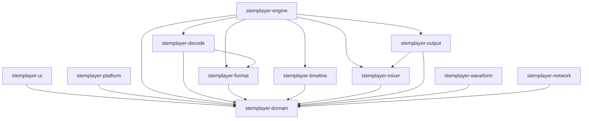

# Crate Responsibilities

Phase 1 defines contracts only. Thin boundary crates contain no production audio, decoding, file parsing, networking, platform integration, or UI implementation.

| Crate | Phase 1 responsibility |
| --- | --- |
| `stemplayer-domain` | Roles, validated values, commands, snapshots, errors, diagnostics, and transport state |
| `stemplayer-timeline` | Checked integer rational time conversion |
| `stemplayer-mixer` | Pure mixer state and output selection |
| `stemplayer-format` | Source inspection trait and local format feature boundary |
| `stemplayer-decode` | Decoder cancellation trait and codec feature boundary |
| `stemplayer-output` | Output lifecycle trait and fake-output feature boundary |
| `stemplayer-engine` | Bounded headless controller harness and dependency enforcement |
| `stemplayer-waveform` | Independent waveform service boundary |
| `stemplayer-network` | Independent network service and HLS feature boundary |
| `stemplayer-platform` | Platform service and integration feature boundary |
| `stemplayer-ui` | Snapshot-only UI port and diagnostics feature boundary |
| `stemplayer-probe` | Deterministic headless CI surface |

The domain crate creates no threads. The Phase 1 headless controller creates no threads and uses a bounded command channel plus capacity-one coalescing snapshot subscriptions.
