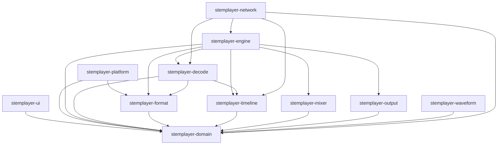

# Crate Responsibilities

Crate boundaries keep implementation dependencies one-directional.

| Crate | Responsibility |
| --- | --- |
| `stemplayer-domain` | Roles, validated values, commands, snapshots, errors, diagnostics, and transport state |
| `stemplayer-timeline` | Checked integer rational time conversion |
| `stemplayer-mixer` | Pure mixer state and output selection |
| `stemplayer-format` | Bounded local format parsing, validation, and source access |
| `stemplayer-decode` | Bounded local and compressed audio decoding |
| `stemplayer-output` | Device lifecycle, output rings, resampling, and qualification |
| `stemplayer-engine` | Playback sessions, scheduling, transport, and dependency enforcement |
| `stemplayer-waveform` | Waveform analysis, caching, priority, and viewport projection |
| `stemplayer-network` | HLS validation, fetching, grouped playback, and diagnostics |
| `stemplayer-platform` | Settings paths, source selection, and OS-specific policy |
| `stemplayer-ui` | Presentation, command adaptation, playhead, and development mock |
| `stemplayer-probe` | Deterministic headless CI surface |

The domain crate creates no threads. The headless controller creates no threads and uses a bounded command channel plus capacity-one coalescing snapshot subscriptions.
